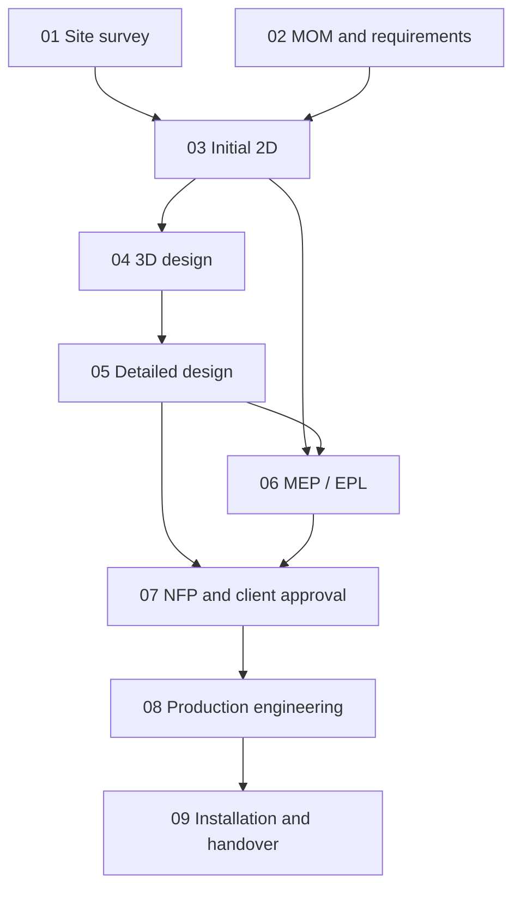

# Interior Studio — Workflow Orchestration and Artifact Lineage

- Status: Proposed baseline
- Scope: operational lifecycle, approvals, revisions, artifact freshness and production gates

## 1. Three separate concepts

Do not represent the entire project with one status field.

### Operational stage
What work is currently being performed?

### Approval milestone
What has been formally approved, by whom, and against which exact revision/artifact manifest?

### Artifact freshness
Does a generated artifact still match the exact inputs from which it was produced?

These models interact, but are not interchangeable.

## 2. Lifecycle stages

| Stage | Name | Main inputs | Main outputs |
|---|---|---|---|
| 01 | Site survey and evidence | Site access, project/space brief | Verified measurements, photos, observations, room geometry |
| 02 | MOM and requirements | Meeting notes, client brief, survey context | Confirmed requirements, scope matrix, actions, open questions |
| 03 | Initial 2D planning | Survey geometry, requirements | Spatial layout, circulation and preliminary plans |
| 04 | 3D design | Approved/selected 2D direction, catalog | Editable 3D scene and presentation views |
| 05 | Detailed design | 3D direction, module/material definitions | Detailed dimensions, elevations, specifications |
| 06 | MEP/EPL coordination | Survey, appliance specs, detailed design | Electrical, plumbing, gas, exhaust and lighting coordination |
| 07 | NFP/client approval | Detailed design, MEP, quote and client deliverables | Approved design revision and artifact manifest |
| 08 | Production engineering | Approved revision, factory rule pack, catalog snapshot | Immutable production package, BOM, shop drawings and exports |
| 09 | Manufacturing, installation and handover | Released production package | Work orders, QC, installation evidence, snags and handover |

Not every project type needs every discipline. Stage prerequisites should be configured by project/space type and enabled product modules [V].

## 3. Dependency graph

Initial dependency proposal:

The graph is a starting point. The workflow engine must support conditional prerequisites, optional stages, loops and rework.

## 4. Stage state machine

Recommended stage states:
- `not_started`
- `in_progress`
- `blocked`
- `ready_for_review`
- `approved`
- `rework_required`
- `completed`
- `skipped` (only where the workflow policy allows it)

A stage transition is a use case, not a UI-only status update.

Each transition evaluates:
- actor authorization;
- project/space scope;
- required inputs;
- unresolved blocking issues;
- required artifact freshness;
- prior approval dependencies;
- subscription entitlement where applicable;
- audit requirements.

## 5. Approval model

An approval records:
- approval type;
- project and space;
- exact design revision;
- exact artifact manifest;
- decision;
- actor;
- timestamp;
- note/conditions;
- policy version.

Approval types may include:
- requirements confirmation;
- preliminary layout approval;
- design approval;
- MEP approval;
- client/NFP approval;
- quote acceptance;
- factory validation;
- production release;
- installation/handover sign-off.

Never retarget an approval to a later revision. A later revision requires a new approval or a policy-driven review decision.

## 6. Artifact lineage

Every generated artifact records:
- artifact ID and type;
- project/space;
- source revision(s);
- source artifact IDs;
- survey and requirements versions where applicable;
- MEP revision;
- catalog/module-definition versions;
- rate-card/tax configuration versions for commercial artifacts;
- rule-pack and export-profile versions for production artifacts;
- generator and schema versions;
- canonical input hash;
- output checksum;
- generation actor/time;
- validation results.

Examples:
- A plan depends on survey geometry and space revision.
- An elevation depends on a design revision.
- An MEP sheet depends on design, appliance and MEP revisions.
- A quote depends on source design, rate card, tax configuration and commercial terms.
- A production package depends on approved design, approved MEP where required, rule pack, catalog and generator.

## 7. Freshness evaluation

Artifact status:
- `draft`
- `generating`
- `current`
- `stale`
- `blocked`
- `approved`
- `superseded`
- `failed`

Freshness is calculated by comparing the artifact's recorded dependency versions/hashes with the current dependency graph.

A changed input marks affected outputs stale. It does not mutate the old artifact or approval.

Use conservative invalidation for high-risk outputs. Production package and release approval remain tied to exact revision/package hashes even if a future fine-grained graph proves some changes unrelated.

## 8. Production release gate

A single server-authoritative use case must own production package generation and release.

Inputs:
- project and space;
- approved source design revision;
- required MEP revision/approval;
- rule-pack ID/version and approval record;
- catalog snapshot version;
- generator version;
- factory export profile version.

Validation:
1. Actor is authenticated and authorized.
2. Project and all inputs belong to the tenant.
3. Source revision is immutable and approved.
4. Required artifacts are current.
5. Rule pack is factory-validated or production-approved according to policy.
6. Provisional and designer-reviewed rule packs are rejected for factory release.
7. Module types are supported by the rule pack.
8. Geometry, constraints and part dimensions pass.
9. Materials/hardware and required manufacturing fields are present.
10. Canonical package serialization and hash pass.
11. Package snapshot is persisted immutably.
12. Release event is audited.

Do not generate a factory export directly from a UI call to the engine. Exports must derive from the persisted immutable package.

## 9. Rework and invalidation examples

- Survey measurement corrected → room geometry and dependent design outputs require review.
- MOM scope changes → affected requirements/design/quote become stale.
- Cabinet width changes → design revision changes; affected elevations, MEP associations, BOM, quote and production package are reconsidered.
- Appliance model changes → clearances, MEP, cabinetry and quote may become stale.
- Material substitution → rendering, specification, BOM and costing become stale.
- Rate card changes → new quotes use new version; historical accepted quote remains unchanged.
- Rule-pack change → new production package required; existing package remains immutable.
- Installation snag → handover remains incomplete until resolved or explicitly accepted.

## 10. Asynchronous jobs

Use a transactional outbox for:
- render generation;
- PDF/DXF/CSV exports;
- large package generation;
- video walkthrough;
- notifications;
- quote delivery;
- external accounting integrations.

Jobs need idempotency key, tenant/project context, source revision/hash, actor, retry count, status, timestamps and result artifact. A worker must re-check authorization and source state before executing sensitive operations.

## 11. Open workflow decisions [V]

- Confirm exact meaning and deliverables of NFP/EPL for the target business.
- Confirm stage prerequisites for kitchens, wardrobes, bedrooms, bathrooms and whole-home projects.
- Confirm who may approve each milestone.
- Confirm whether client approval is captured inside the app, by signed document or both.
- Confirm factory validation and production-release authority.
- Confirm installation QC checklist and warranty handover requirements.
