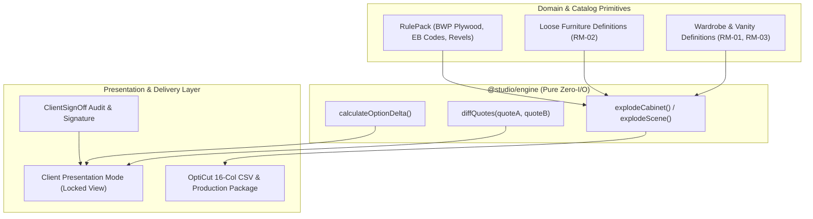

# 023 Design — Multi-Room Packs, Wardrobe Parametric Modules & Client Presentation Portal

## Architecture & Data Flow



## 1. Domain Schemas

### 1.1 Wardrobe & Loose Furniture Module Kinds
In `src/domain/manufacturing/moduleDefinition.ts`:
Extend `ModuleKind` with:
- `'wardrobe-hinged'`: Tall carcass with top/bottom shelf, hanging rail, optional internal drawer partition.
- `'wardrobe-sliding'`: Tall carcass with slider top/bottom guides, internal divider, and adjustable shelving.
- `'vanity-bwp'`: Moisture-resistant carcass (BWP grade plywood), sink cutout, false drawer/shutter.
- `'loose-table'`: 4-leg dining or study table with solid top, aprons, and corner gussets.

### 1.2 Quote Diffing & Option Pricing
In `src/engine/commercial/quoteDiff.ts`:
```ts
export interface QuoteDiffResult {
  added: QuoteLineItem[];
  removed: QuoteLineItem[];
  modified: Array<{
    itemKey: string;
    description: string;
    oldQty: number;
    newQty: number;
    oldTotalPaise: number;
    newTotalPaise: number;
    deltaPaise: number;
  }>;
  subtotalDeltaPaise: number;
  taxDeltaPaise: number;
  grandTotalDeltaPaise: number;
}
```

### 1.3 Client Sign-Off Schema
In `src/domain/platform/signOff.ts`:
```ts
export const ClientSignOffSchema = z.object({
  id: z.string(),
  quoteId: z.string(),
  quoteSha256: z.string(),
  clientName: z.string().min(1),
  clientMobile: z.string().min(10),
  status: z.enum(['pending', 'accepted', 'rejected']),
  timestamp: z.string(),
  ipAddress: z.string(),
  consentNoticeVersion: z.string(),
  notes: z.string().optional(),
});
```

## 2. UI Presentation & Security
- `PresentationPortalModal`: Clean, full-bleed client review dialog.
- Watermarked with Studio Logo and Client Project Details.
- Excludes:
  - Internal cost per board
  - Factory margin %
  - OptiCut panel saw export buttons
- Includes:
  - Interactive Project Preview
  - Dimensioned Sheet Views
  - Statutory GST Tax Summary (HSN 9403 / SAC 9954)
  - One-click "Accept Quote" with confirmation modal generating a signed `ClientSignOff` record.

