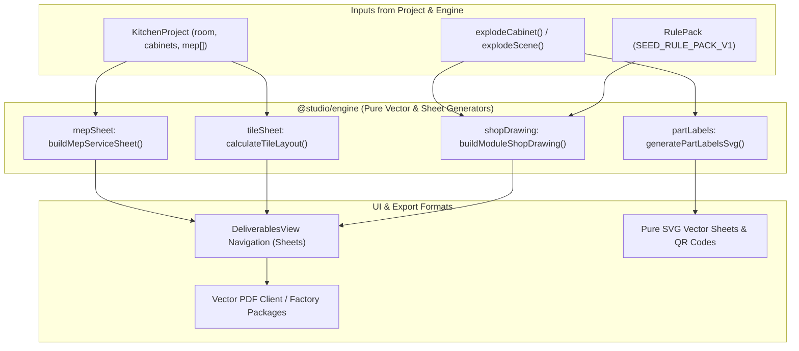

# 024 Design — Technical MEP Sheets, Tile Calculator, Shop Drawings & Factory Part Labels

## Architecture & Data Flow

## 1. MEP Service Drawing Sheet (`mepSheet.ts`)
- Builds an engineering view with:
  - Perimeter wall boundaries and openings.
  - Cabinet outline footprints (dashed line `Stroke = 'hidden'`).
  - MEP symbols:
    - Electrical 16A / 6A: Tag circle with symbol `E16` or `E6`, at point coordinates $(x, y)$ along wall, plus dimension arrow to nearest wall corner.
    - Water Inlet: Tag circle with `W_IN` (blue).
    - Water Drain: Tag circle with `W_OUT` (cyan).
    - Gas: Tag circle with `GAS` (amber).
    - Chimney: Tag circle with `CHIM` (purple).
  - Schedule table of MEP points at bottom of sheet listing: Point ID, Type, Wall, Distance from Datum (mm), Height AFF (mm), and Circuit/Appliance notes.

## 2. Tile Layout & Quantity Calculator (`tileSheet.ts`)
- Input: `KitchenProject`, `tileWidthMm` (default 300), `tileHeightMm` (default 600), `wastagePct` (default 10%).
- Computation:
  - Dado wall height: standard 600mm above 860mm finished counter (between counter and wall cabinets).
  - Net Dado Area: Wall lengths with counter $\times 600\text{mm} - \text{openings}$.
  - Tiles required: $\lceil (\text{Net Area} / \text{Tile Area}) \times 1.10 \rceil$.
  - Boxes required based on standard 8 tiles/box.
- Generates a Tile Schedule Sheet with tile dimensions, joint spacing (2mm), and hatch preview.

## 3. Module Shop Drawing Sheet (`shopDrawing.ts`)
- Generates orthographic panel views for an exploded cabinet:
  - Side Gables ($H \times D$) with 32mm system line boring coordinates at 37mm setback.
  - Bottom Panel ($W - 2\times tc \times D$).
  - Top Stretchers / Top Panel.
  - Grooved Back Panel with rebate callouts.
  - Shutters with 35mm hinge cup circles ($22.5\text{mm}$ from edge).
  - Bill of constituent panels with finished vs cutting dimensions and edge-band indicator codes.

## 4. Factory Part Labels (`partLabels.ts`)
- Pure SVG generator:
  - Thermal Roll 100×50mm viewbox.
  - A4 sheet (3×7 grid of 70×42.4mm labels).
  - SVG QR code renderer (compact 21×21 module matrix generator without external dependencies).
  - Edge-banding code compass (L1 top, L2 bottom, W1 front, W2 back).

