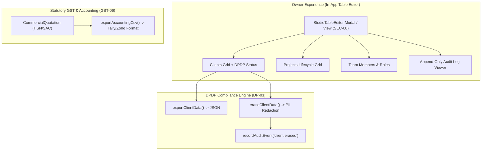

# 025 Design — Studio Table Editor, DPDP Data Erasure & Accounting Export

## Architecture & Data Flow



## 1. DPDP Compliance Functions
In `src/domain/platform/dpdp.ts`:
```ts
export interface ClientRecord {
  id: string;
  orgId: string;
  name: string;
  mobile: string;
  email?: string;
  siteAddress?: string;
  gstin?: string;
  consentId?: string;
  consentTimestamp?: string;
  consentNoticeVersion?: string;
  isAnonymized?: boolean;
}

export function exportClientData(client: ClientRecord, projects: KitchenProject[]): string;
export function eraseClientData(client: ClientRecord): { updatedClient: ClientRecord; auditPayload: Record<string, unknown> };
```

## 2. Accounting CSV Export for Tally / Zoho Books
In `src/engine/commercial/accountingCsv.ts`:
```ts
export interface AccountingVoucherMeta {
  voucherNumber: string;
  voucherDate: string;
  clientName: string;
  clientGstin?: string;
  placeOfSupply: string;
  studioGstin: string;
}

export function generateAccountingCsv(quote: CommercialQuotation, meta: AccountingVoucherMeta): string;
```

## 3. Studio Table Editor UI
In `src/features/table-editor/StudioTableEditor.tsx`:
- Tabs:
  - `clients`: Searchable table with columns (Name, Mobile, Email, Address, DPDP Consent, Actions). Action buttons: "Export Data" and "Erase PII".
  - `projects`: Searchable table with columns (ID, Name, Status, Revision, Actions).
  - `members`: Searchable table with columns (User, Role, Actions).
  - `audit`: Paginated/scrollable view of immutable audit logs with JSON diff inspection.

