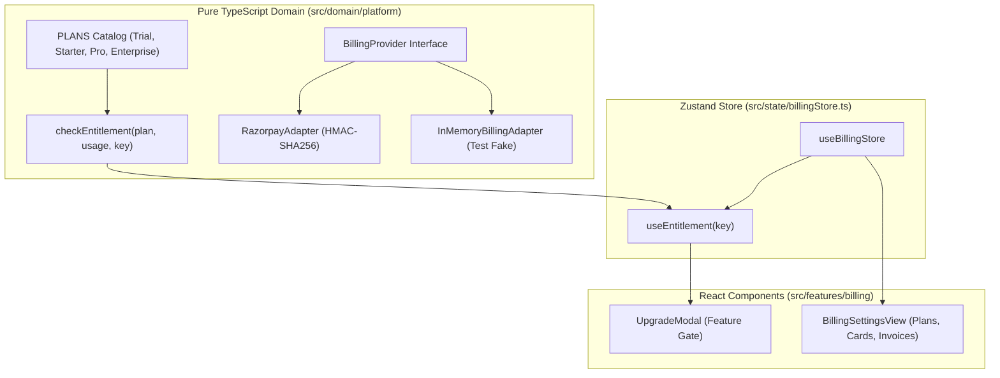

# 026 Design — Razorpay Subscriptions & Feature Entitlement Gates

## Architecture & Data Flow



## 1. Plan Models & Entitlements Schema
In `src/domain/platform/entitlements.ts`:
```ts
export type PlanTier = 'trial' | 'starter' | 'pro' | 'enterprise';

export type FeatureKey =
  | 'projects.max_active'
  | 'seats.designers'
  | 'cutlist.export'
  | 'drawings.dxf'
  | 'accounting.export'
  | 'ai.layout'
  | 'custom_rulepack';

export interface PlanDefinition {
  id: PlanTier;
  name: string;
  priceMonthlyPaise: number;
  priceAnnualPaise: number;
  features: {
    maxActiveProjects: number; // -1 for unlimited
    maxDesigners: number;
    cutlistExport: boolean;
    dxfExport: boolean;
    accountingExport: boolean;
    aiLayout: boolean;
    customRulepack: boolean;
  };
}
```

## 2. Billing Provider & Adapter
In `src/domain/platform/billing.ts`:
```ts
export type SubscriptionStatus =
  | 'created'
  | 'authenticated'
  | 'active'
  | 'pending'
  | 'halted'
  | 'cancelled'
  | 'completed';

export interface SubscriptionRecord {
  id: string;
  orgId: string;
  planId: PlanTier;
  billingCycle: 'monthly' | 'annual';
  status: SubscriptionStatus;
  currentPeriodStart: string;
  currentPeriodEnd: string;
  razorpaySubscriptionId?: string;
  razorpayCustomerId?: string;
}

export interface BillingProvider {
  createSubscription(params: {
    orgId: string;
    planId: PlanTier;
    cycle: 'monthly' | 'annual';
    customerEmail: string;
  }): Promise<SubscriptionRecord>;
  cancelSubscription(subscriptionId: string): Promise<SubscriptionRecord>;
  verifyWebhook(body: string, signature: string, secret: string): Promise<boolean>;
}
```

## 3. UI Gating & Settings
- Hook `useEntitlement(key)`: Returns `{ allowed, reason, upgradeRequired }`.
- Gated actions in `DeliverablesView.tsx`:
  - `dxf-plan` requires `'drawings.dxf'`
  - `accounting-csv` requires `'accounting.export'`
- When clicked on a restricted tier, opens `<UpgradeModal planNeeded="pro" />` with an upgrade call-to-action.
- `BillingSettingsView.tsx`: Displays active plan card, plan switcher, and downloadable GST invoice history.

