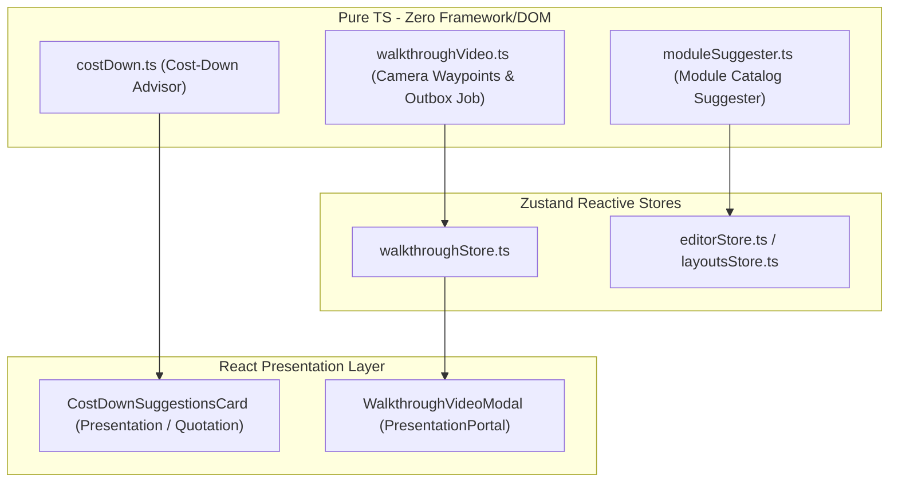

# Design 027 — AI Layout Suggester, Cost-Down Advisor & Walkthrough Video Outbox Worker

## Architecture & Layers



## Domain Contracts

### 1. Cost-Down Advisor (`src/engine/commercial/costDown.ts`)
```ts
export interface CostDownSuggestion {
  id: string;
  type: 'consolidate_units' | 'standardize_width';
  title: string;
  description: string;
  elementIdsToReplace: string[];
  replacementModuleCode: string;
  replacementWidthMm: number;
  savingsPaise: number;
  formattedSavings: string;
  explanation: string;
}

export function analyzeCostDownOpportunities(
  elements: KitchenElement[],
  rulePack: RulePack
): CostDownSuggestion[];
```

### 2. Walkthrough Video Worker Contract (`src/domain/platform/walkthroughVideo.ts`)
```ts
export interface CameraWaypoint {
  timeSec: number;
  position: { x: number; y: number; z: number };
  target: { x: number; y: number; z: number };
  fov: number;
}

export interface VideoRenderJob {
  id: string;
  projectId: string;
  durationSec: number; // 30
  resolution: '1080p' | '720p';
  fps: number; // 30 or 60
  status: 'queued' | 'rendering' | 'ready' | 'failed';
  progressPct: number;
  waypoints: CameraWaypoint[];
  downloadUrl?: string;
  createdAtIso: string;
  completedAtIso?: string;
}

export function generateWalkthroughPath(
  room: { width: number; length: number; height: number },
  elements: KitchenElement[],
  durationSec?: number
): CameraWaypoint[];
```

