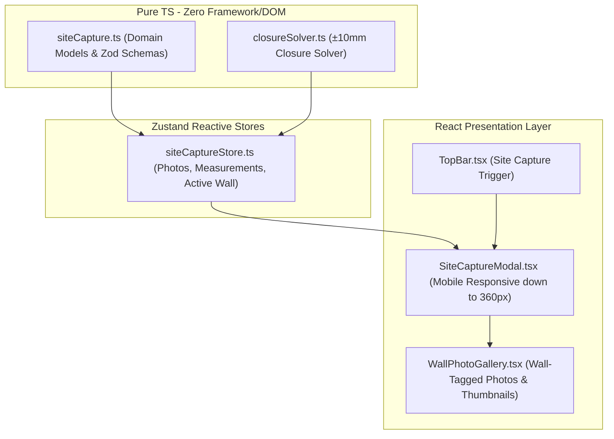

# Design 028 — Site Measurement Capture & Wall-Tagged Photos

## Architecture & Layers



## Domain Contracts

### 1. `src/domain/measurement/siteCapture.ts`
```ts
export interface SitePhoto {
  id: string;
  projectId: string;
  wallId: 'back' | 'left' | 'right' | 'front';
  url: string; // Base64 or object URL
  caption?: string;
  compassHeading?: number; // 0 - 360 degrees
  capturedAtIso: string;
}

export interface WallMeasurement {
  wallId: 'back' | 'left' | 'right' | 'front';
  measuredLengthMm: number;
  heightMm: number;
  notes?: string;
}

export interface ClosureResult {
  isClosed: boolean;
  closureErrorMm: number;
  status: 'acceptable' | 'warning';
  explanation: string;
}
```

### 2. `src/engine/measurement/closureSolver.ts`
```ts
export function evaluateRoomClosure(
  walls: { wallId: string; lengthMm: number }[]
): ClosureResult;
```
For a 4-wall rectangular loop:
- `back` should equal `front`
- `left` should equal `right`
- Total diagonal check or Cartesian vector sum error: $\Delta = \sqrt{(L_{back} - L_{front})^2 + (L_{left} - L_{right})^2}$
- If $\Delta \le 10$ mm: Status is `acceptable`.
- If $\Delta > 10$ mm: Status is `warning` with recommended check.
