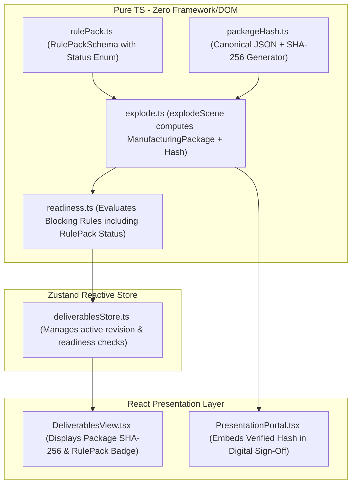

# Design 029 — Immutable Production Packages, SHA-256 Hashing & RulePack Lifecycle Gates

## Architecture & Layers



## Data Contracts

### 1. RulePack Status & Schema (`src/domain/manufacturing/rulePack.ts`)
```ts
export type RulePackStatus =
  | 'provisional'
  | 'designer_reviewed'
  | 'factory_validated'
  | 'production_approved';

export const RulePackSchema = z.object({
  id: z.string(),
  name: z.string(),
  version: z.number().int().positive(),
  status: z.enum([
    'provisional',
    'designer_reviewed',
    'factory_validated',
    'production_approved',
  ]).default('provisional'),
  signedOffBy: z.string().optional(),
  signedOffAtIso: z.string().optional(),
  // Joinery parameters (carcassThickness, reveals, edge-band codes...)
  ...
});
```

### 2. Canonical JSON Serialization & SHA-256 Hash (`src/engine/manufacturing/packageHash.ts`)
```ts
export function canonicalStringify(obj: unknown): string;
export async function computePackageSha256(payload: unknown): Promise<string>;
export function computePackageSha256Sync(payload: unknown): string; // Using Node crypto when available, or pure JS fallback
```

### 3. Manufacturing Package Contract (`src/engine/manufacturing/explode.ts`)
```ts
export interface ManufacturingPackage {
  packageId: string;
  projectId: string;
  schemaVersion: number;
  rulePackId: string;
  rulePackVersion: number;
  rulePackStatus: RulePackStatus;
  canonicalHash: string; // 64-char lowercase SHA-256 hex
  parts: ManufacturingPart[];
  hardware: ManufacturingHardware[];
  edgeBandSummary: EdgeBandSummaryItem[];
  summary: ManufacturingSummary;
  generatedAtIso: string;
}
```
