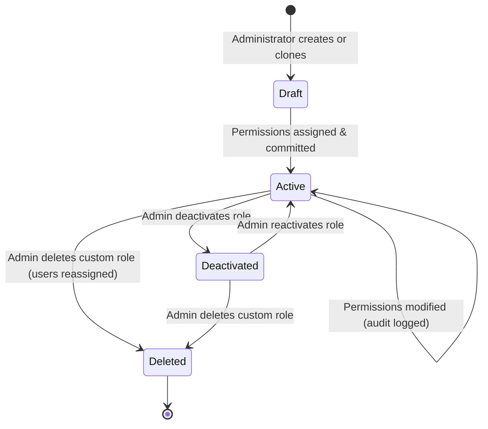

# Phase 1 Data Model: Centralized Modular Architecture & Dynamic Authorization Platform

**Feature**: `030-centralized-authorization`  
**Date**: 2026-11-02  
**Status**: Completed  

---

## 1. Domain Entities & Schemas (TypeScript / Zod)

### Resource Scope Types
```typescript
export type ResourceScopeType =
  | 'all_projects'
  | 'assigned_projects'
  | 'team_projects'
  | 'client_projects';
```

### Module Definition Schema
```typescript
export interface ModuleCapability {
  key: string;
  title: string;
  description: string;
  defaultScopes: ResourceScopeType[];
}

export interface ModuleDefinition {
  id: string; // e.g. "module-projects", "module-cad-engine", "module-commercial"
  name: string; // e.g. "Projects & Site Surveys"
  version: string; // semver
  description: string;
  dependencies: string[]; // module IDs
  capabilities: ModuleCapability[];
}
```

### Permission Definition Schema
```typescript
export interface PermissionDefinition {
  id: string; // e.g. "projects.create", "designs.3d.export"
  moduleId: string;
  resource: string;
  action: string;
  title: string;
  description: string;
  supportedScopes: ResourceScopeType[];
}
```

### Custom Role Schema
```typescript
export type RoleStatus = 'active' | 'deactivated';

export interface CustomRole {
  id: string;
  orgId: string | null; // null for immutable system roles
  name: string;
  description: string;
  rank: number; // 1-100 (Owner = 100, Admin = 80, Designer = 60, etc.)
  isSystemRole: boolean;
  status: RoleStatus;
  createdAt: string; // ISO 8601
  updatedAt: string; // ISO 8601
}
```

### Role Permission Mapping Schema
```typescript
export interface RolePermissionMapping {
  roleId: string;
  permissionId: string;
  scopeType: ResourceScopeType;
}
```

### User Role Assignment Schema
```typescript
export interface UserRoleAssignment {
  id: string;
  orgId: string;
  userId: string;
  roleId: string;
  assignedBy: string; // Actor user ID
  assignedAt: string; // ISO 8601
}
```

### Authorization Evaluation Context & Result
```typescript
export interface ResourceContext {
  projectId?: string;
  assignedUserIds?: string[];
  teamId?: string;
  clientId?: string;
}

export interface AuthorizationEvaluationResult {
  allowed: boolean;
  reason?: string;
  applicableScope?: ResourceScopeType;
  evaluatedRoles: string[];
  missingPermissions?: string[];
}
```

---

## 2. Database Relational Model (PostgreSQL / Supabase)

### Table: `public.roles`
Extended from migration `00002_rbac_and_entitlements.sql`:
```sql
CREATE TABLE IF NOT EXISTS public.roles (
  id text PRIMARY KEY,
  org_id uuid REFERENCES public.organizations(id) ON DELETE CASCADE, -- NULL for system templates
  name text NOT NULL,
  description text NOT NULL,
  rank integer NOT NULL CHECK (rank BETWEEN 1 AND 100),
  is_system_role boolean NOT NULL DEFAULT false,
  status text NOT NULL DEFAULT 'active' CHECK (status IN ('active', 'deactivated')),
  created_at timestamptz NOT NULL DEFAULT now(),
  updated_at timestamptz NOT NULL DEFAULT now()
);

-- Index for tenant queries
CREATE INDEX IF NOT EXISTS idx_roles_org_id ON public.roles(org_id);
```

### Table: `public.permissions`
```sql
CREATE TABLE IF NOT EXISTS public.permissions (
  id text PRIMARY KEY, -- e.g. 'designs.3d.export'
  module_id text NOT NULL,
  action text NOT NULL,
  title text NOT NULL,
  description text NOT NULL,
  supported_scopes text[] NOT NULL DEFAULT '{"all_projects"}',
  created_at timestamptz NOT NULL DEFAULT now()
);

CREATE INDEX IF NOT EXISTS idx_permissions_module_id ON public.permissions(module_id);
```

### Table: `public.role_permissions`
```sql
CREATE TABLE IF NOT EXISTS public.role_permissions (
  role_id text REFERENCES public.roles(id) ON DELETE CASCADE,
  permission_id text REFERENCES public.permissions(id) ON DELETE CASCADE,
  scope_type text NOT NULL DEFAULT 'all_projects' 
    CHECK (scope_type IN ('all_projects', 'assigned_projects', 'team_projects', 'client_projects')),
  PRIMARY KEY (role_id, permission_id)
);
```

### Table: `public.project_members` (Resource Scope Junction)
```sql
CREATE TABLE IF NOT EXISTS public.project_members (
  project_id uuid REFERENCES public.projects(id) ON DELETE CASCADE,
  user_id uuid NOT NULL,
  created_at timestamptz NOT NULL DEFAULT now(),
  PRIMARY KEY (project_id, user_id)
);

CREATE INDEX IF NOT EXISTS idx_project_members_user ON public.project_members(user_id, project_id);
```

---

## 3. State Transitions

### Custom Role Lifecycle


### Immutability Rules:
1. **System Roles (`is_system_role = true`)**: Cannot transition to `Deactivated` or `Deleted`. Modifications to their permission mappings are rejected by database triggers.
2. **Owner Role (`rank = 100`)**: Cannot be deleted or have `org:manage` revoked, enforced by `prevent_last_owner_removal` trigger.
