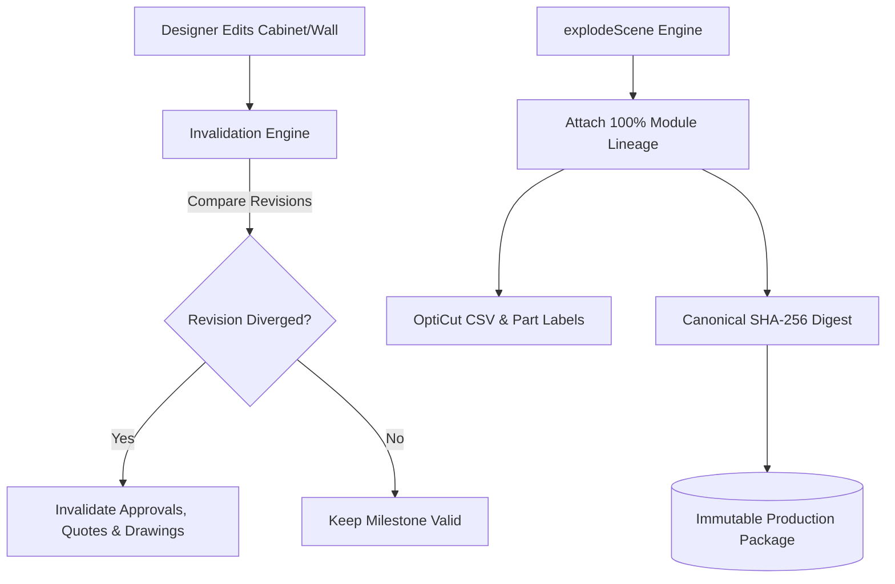

# Design Spec 032: End-to-End Pilot Journey, Lifecycle Invalidation & Cut-List Part Traceability

## 1. Domain Models & Schemas

### 1.1 Project Lifecycle State Machine (`src/domain/project/lifecycle.ts`)

```typescript
export const ProjectLifecycleStateSchema = z.enum([
  'draft',
  'client_presented',
  'quote_approved',
  'design_approved',
  'factory_validated',
  'production_released',
]);
export type ProjectLifecycleState = z.infer<typeof ProjectLifecycleStateSchema>;

export interface InvalidationCheckResult {
  isCurrent: boolean;
  activeRevision: string;
  approvedRevision: string | null;
  invalidatedMilestones: Array<{
    state: ProjectLifecycleState;
    reason: string;
    approvedAt: string;
  }>;
}
```

### 1.2 Rate Card Schema (`src/domain/commercial/rateCard.ts`)

```typescript
export const RateCardSchema = z.object({
  id: z.string(),
  version: z.string(),
  effectiveFrom: z.string(),
  name: z.string(),
  carcassRatePerSqMPaise: z.number().int().min(0),
  shutterRatesPerSqMPaise: z.record(z.string(), z.number().int().min(0)),
  edgeBandingRatePerMeterPaise: z.number().int().min(0),
  hardwareUnitRatesPaise: z.record(z.string(), z.number().int().min(0)),
  marginPercent: z.number().min(0).max(100),
  gstGoodsPercent: z.number().default(18),
  gstServicesPercent: z.number().default(18),
});
export type RateCard = z.infer<typeof RateCardSchema>;
```

### 1.3 Full Part Traceability Schema (`src/domain/manufacturing/types.ts`)

Every part in `ManufacturingPart` must contain:
```typescript
{
  id: string;
  name: string;
  moduleId: string;
  moduleType: string;
  moduleDefinitionVersion: string;
  rulePackId: string;
  rulePackVersion: string;
  rulePackStatus: RulePackStatus;
  material: string;
  thicknessMm: number;
  finishedWidth: number;
  finishedLength: number;
  cutWidth: number;
  cutLength: number;
  edgeBanding: {
    top: boolean;
    bottom: boolean;
    left: boolean;
    right: boolean;
    thicknessMm: number;
  };
  generationAlgorithmVersion: string;
}
```

---

## 2. Architecture & Data Flow



