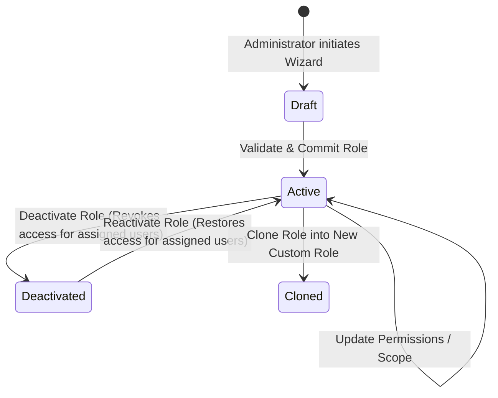

# Data Model & Schema Definitions: Feature 033

**Feature**: Role Management Dashboard, Hierarchical Permission Matrix, and Guided Role Editor  
**Branch**: `033-role-management-and-permission-matrix`  
**Date**: 2026-11-03  

---

## 1. Domain Entities & Schemas

### 1.1 Resource Scope Type
```typescript
import { z } from 'zod';

export const ResourceScopeTypeSchema = z.enum([
  'all_projects',
  'team_projects',
  'assigned_projects',
  'specific_projects',
]);
export type ResourceScopeType = z.infer<typeof ResourceScopeTypeSchema>;
```

### 1.2 Module Action Types
```typescript
export const ModuleActionSchema = z.enum([
  'view',
  'create',
  'edit',
  'delete',
  'approve',
  'export',
]);
export type ModuleAction = z.infer<typeof ModuleActionSchema>;
```

### 1.3 Permission Definition
```typescript
export const PermissionDefinitionSchema = z.object({
  id: z.string().min(1), // e.g. 'designs.3d.export'
  moduleId: z.string().min(1), // e.g. 'module-cad-engine'
  resource: z.string().min(1), // e.g. 'designs'
  action: ModuleActionSchema,
  title: z.string().min(1),
  description: z.string(),
  entitlementKey: z.string().optional(), // canonical key e.g. 'feature.design.3d.export_cad'
  isHighRisk: z.boolean().default(false), // e.g. delete, pii, role admin
  supportedScopes: z.array(ResourceScopeTypeSchema).min(1).default(['all_projects']),
});
export type PermissionDefinition = z.infer<typeof PermissionDefinitionSchema>;
```

### 1.4 Module Definition
```typescript
export const ModuleDefinitionSchema = z.object({
  id: z.string().min(1), // e.g. 'module-cad-engine'
  name: z.string().min(1),
  category: z.string().default('core'),
  order: z.number().int().default(100),
  description: z.string(),
  icon: z.string().default('box'),
  actionsSupported: z.array(ModuleActionSchema),
  permissions: z.array(PermissionDefinitionSchema),
});
export type ModuleDefinition = z.infer<typeof ModuleDefinitionSchema>;
```

### 1.5 Custom Role Entity
```typescript
export const RoleStatusSchema = z.enum(['active', 'deactivated']);
export type RoleStatus = z.infer<typeof RoleStatusSchema>;

export const RoleResourceScopeConfigSchema = z.object({
  scopeType: ResourceScopeTypeSchema.default('all_projects'),
  specificProjectIds: z.array(z.string()).default([]),
  teamIds: z.array(z.string()).default([]),
});
export type RoleResourceScopeConfig = z.infer<typeof RoleResourceScopeConfigSchema>;

export const CustomRoleSchema = z.object({
  id: z.string().min(1),
  orgId: z.string().uuid().nullable(), // null for immutable system role templates
  name: z.string().min(1).max(100),
  description: z.string().max(500).default(''),
  rank: z.number().int().min(1).max(100), // Owner = 100, Admin = 80, Designer = 60, Reviewer = 40, Viewer = 20
  isSystemRole: z.boolean().default(false),
  status: RoleStatusSchema.default('active'),
  scopeConfig: RoleResourceScopeConfigSchema.default({ scopeType: 'all_projects', specificProjectIds: [], teamIds: [] }),
  createdAt: z.string().datetime(),
  updatedAt: z.string().datetime(),
});
export type CustomRole = z.infer<typeof CustomRoleSchema>;
```

### 1.6 Role Permission Mapping
```typescript
export const RolePermissionMappingSchema = z.object({
  roleId: z.string().min(1),
  permissionId: z.string().min(1),
  moduleId: z.string().min(1),
  action: ModuleActionSchema,
  scopeType: ResourceScopeTypeSchema.default('all_projects'),
});
export type RolePermissionMapping = z.infer<typeof RolePermissionMappingSchema>;
```

### 1.7 User Role Assignment
```typescript
export const UserRoleAssignmentSchema = z.object({
  id: z.string().min(1),
  orgId: z.string().uuid(),
  userId: z.string().min(1),
  userName: z.string().default(''),
  userEmail: z.string().default(''),
  roleId: z.string().min(1),
  roleName: z.string().default(''),
  assignedBy: z.string().min(1),
  assignedAt: z.string().datetime(),
});
export type UserRoleAssignment = z.infer<typeof UserRoleAssignmentSchema>;
```

### 1.8 Role Predefined Template
```typescript
export const RoleTemplateSchema = z.object({
  id: z.string().min(1),
  name: z.string().min(1),
  description: z.string(),
  category: z.string(),
  defaultRank: z.number().int(),
  recommendedScope: ResourceScopeTypeSchema,
  grantedPermissionIds: z.array(z.string()),
});
export type RoleTemplate = z.infer<typeof RoleTemplateSchema>;
```

### 1.9 Role Audit Event
```typescript
export const RoleAuditEventSchema = z.object({
  id: z.string().min(1),
  orgId: z.string().uuid(),
  actorId: z.string().min(1),
  actorName: z.string().default('Admin'),
  roleId: z.string().min(1),
  roleName: z.string(),
  actionType: z.enum([
    'created',
    'updated',
    'cloned',
    'deactivated',
    'reactivated',
    'assigned',
    'unassigned',
  ]),
  changesSummary: z.string(),
  addedPermissions: z.array(z.string()).default([]),
  removedPermissions: z.array(z.string()).default([]),
  previousScope: ResourceScopeTypeSchema.optional(),
  newScope: ResourceScopeTypeSchema.optional(),
  affectedUserCount: z.number().int().default(0),
  timestamp: z.string().datetime(),
});
export type RoleAuditEvent = z.infer<typeof RoleAuditEventSchema>;
```

---

## 2. Predefined Industry Role Templates

| Template ID | Name | Description | Default Scope | Key Capabilities |
| :--- | :--- | :--- | :--- | :--- |
| `tpl-project-manager` | **Project Manager** | Full project lifecycle, client communications, quotes, and team coordination. | `all_projects` | Projects (all), 2D/3D (view), Estimates (view/send), Clients (manage), Reports (view/export) |
| `tpl-senior-designer` | **Senior Designer** | Comprehensive design authoring, 3D photoreal rendering, CAD exports, and catalog customization. | `all_projects` | Projects (view/edit), 2D/3D (all), Materials (all), Furniture (all), Deliverables (generate/share) |
| `tpl-designer` | **Designer** | Standard 2D drafting and 3D modeling on assigned projects. | `assigned_projects` | Projects (view/edit assigned), 2D/3D (view/edit), Furniture (browse/custom_param) |
| `tpl-reviewer` | **Reviewer** | Quality assurance, client lookbook approval, and deliverables signoff. | `all_projects` | Projects (view), 2D/3D (view), Deliverables (view/approve/share), Quotes (view) |
| `tpl-client-viewer` | **Client Viewer** | Read-only presentation portal for approved client deliverables. | `assigned_projects` | 3D Viewport (view only), Presentations (view approved), Share links (view) |

---

## 3. State Machine & Invariants



### Invariants:
1. **System Role Immutability**: Roles where `isSystemRole === true` cannot have their `name`, `rank`, or `permissions` modified or deleted. They can only be cloned.
2. **Last-Owner Lockout Prevention**: In any organization, at least one user must hold the `Owner` system role (`rank === 100`). Deleting, unassigning, or deactivating the last active Owner throws `CANNOT_REMOVE_LAST_OWNER`.
3. **No Silent Upgrades**: New permissions added to the platform module registry default to denied for existing custom roles.
4. **Subscription Decoupling**: Role permissions remain saved even when the tenant lacks the subscription entitlement. Runtime evaluation checks subscription validity independently.
