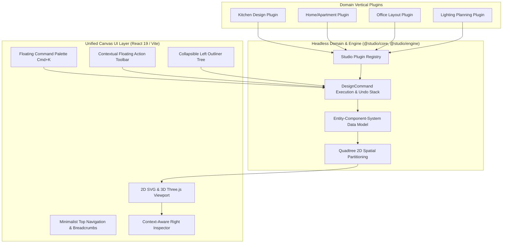

# Design Spec 033: Unified Design Studio Architecture & UI/UX Redesign

## 1. Architectural Blueprint & Component Overview



---

## 2. Entity-Component-System (ECS) Data Model (`src/domain/ecs/types.ts`)

```typescript
export interface EntityId {
  readonly id: string;
}

export interface TransformComponent {
  x: number; // integer mm
  y: number; // integer mm
  z: number; // integer mm
  width: number;  // integer mm
  height: number; // integer mm
  depth: number;  // integer mm
  rotation: number; // degrees: 0, 90, 180, 270
}

export interface MaterialComponent {
  materialId: string;
  finishCategory: string;
  finishName: string;
  colorHex?: string;
  textureUri?: string;
}

export interface PricingComponent {
  hsnSacCode: string;
  unitRatePaise: number; // integer paise
  marginPercent: number;
  itemType: 'goods' | 'services';
}

export interface ManufacturingComponent {
  rulePackId: string;
  rulePackVersion: number;
  isManufacturable: boolean;
  edgeBandSpec?: {
    l1?: string;
    l2?: string;
    w1?: string;
    w2?: string;
  };
}

export interface WorkspaceEntity {
  id: string;
  entityType: 'wall' | 'opening' | 'cabinet' | 'furniture' | 'fixture';
  name: string;
  layer: string;
  transform: TransformComponent;
  material?: MaterialComponent;
  pricing?: PricingComponent;
  manufacturing?: ManufacturingComponent;
  customComponents?: Record<string, unknown>;
}
```

---

## 3. Quadtree Spatial Partitioning Engine (`src/engine/spatial/quadtree.ts`)

Integer millimeter 2D spatial index:
- Bounding Box: `{ minX, minY, maxX, maxY }`
- Max items per node: 8, max depth: 6
- Methods:
  - `insert(item: SpatialItem<T>): void`
  - `queryPoint(x: number, y: number): T[]`
  - `queryBounds(box: BoundingBox2D): T[]`
  - `remove(id: string): boolean`
  - `clear(): void`

---

## 4. Plugin Architecture (`src/domain/plugins/types.ts`)

```typescript
export interface PluginToolbarItem {
  id: string;
  label: string;
  iconName: string;
  commandName: string;
  shortcut?: string;
}

export interface StudioPlugin {
  id: string;
  name: string;
  version: string;
  description: string;
  supportedEntityTypes: string[];
  toolbarItems: PluginToolbarItem[];
  defaultRulePackId?: string;
  onActivate?: () => void;
  onDeactivate?: () => void;
}
```

---

## 5. UI/UX Hierarchy: Canvas-First Layout

1. **Top Bar**:
   - Breadcrumb navigation (`Projects > Villa Horizon > Kitchen`)
   - Autosave badge (`Saved` / `Unsaved`)
   - View mode pills: `3D` (`1`), `Plan` (`2`), `Split` (`3`), `Deliverables` (`4`)
   - Quick Command button (`Cmd+K` pill)
2. **Floating Command Palette (`Cmd+K`)**:
   - Keyboard-first command discovery and execution
   - Instant search across tools, presets, view modes, and export actions
3. **Left Sidebar (Outliner & Catalog)**:
   - Hierarchical Scene Tree: displays walls, openings, and cabinet runs with toggleable visibility and quick selection
   - Tab switch between Outliner and Catalog
4. **Contextual Floating Toolbar**:
   - Appears immediately above or adjacent to selected 2D/3D entities with fast actions (Rotate 90°, Focus F, Duplicate, Delete).

